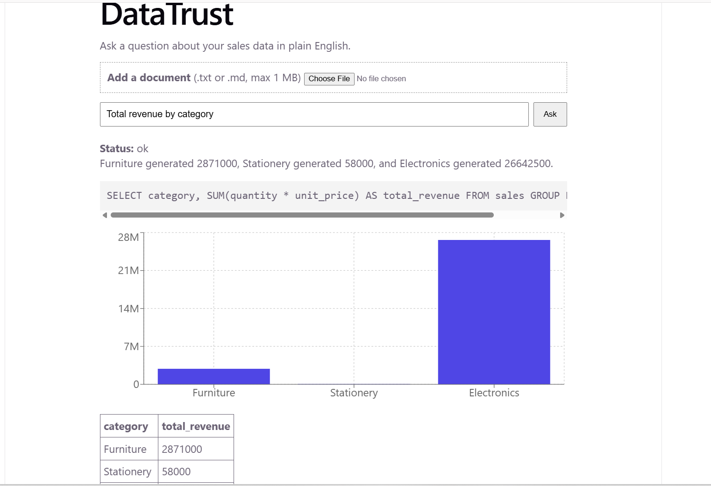
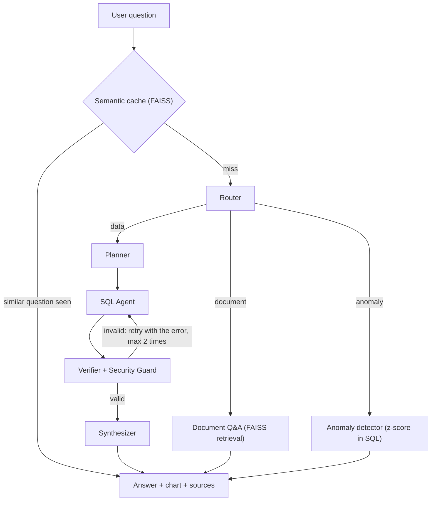

# DataTrust

Ask questions about your data in plain English and get **verified SQL**, an instant chart, and an answer you can check.



DataTrust is a multi-agent NL-to-SQL platform. Instead of letting one LLM guess a query, every question passes through a pipeline of small agents that plan, write, and verify the SQL before anything is run. It also answers questions from uploaded documents and flags unusual records.

## How it works



## The five-stage SQL pipeline

1. **Router** decides whether the question needs the sales data, a document, or an anomaly check.
2. **Planner** picks the columns needed and rejects the question early if the data does not contain them (for example, asking for "profit" when there is no cost column).
3. **SQL Agent** writes one DuckDB query using only the real schema.
4. **Verifier + Security Guard** blocks anything that is not a single read-only `SELECT`, then asks DuckDB to `EXPLAIN` the query. A made-up column fails here, and the error is sent back to the SQL Agent for a retry.
5. **Synthesizer** runs the verified query, picks a chart type by rule, and writes a short answer using only the returned numbers.

## Features

- **Hallucination reduction at several layers:** the schema is given to the model, the Planner checks columns, the Verifier checks the query against the real database, and the Synthesizer may only use returned data.
- **SQL security guard:** only one read-only `SELECT` is allowed. It blocks multiple statements, SQL comments, data-changing keywords, and file-reading functions.
- **FAISS semantic cache:** a reworded repeat of a question is answered instantly with no LLM calls, while a different question (such as "by region" vs "by category") is not reused.
- **Document Q&A (RAG):** upload a `.txt` or `.md` file and ask about it. Answers come only from the retrieved passages, the passages are shown as sources, and the model says so when the document does not contain the answer.
- **Anomaly detection:** flags orders whose quantity is far from normal for their product, using a z-score computed in SQL. No LLM is involved.
- **Instant visualizations:** bar, line, or big-number charts chosen automatically.

## Tech stack

| Layer | Tools |
|---|---|
| Backend | Python, FastAPI |
| Database | DuckDB |
| Vector search | FAISS, fastembed (`BAAI/bge-small-en-v1.5`) |
| LLM | Any OpenAI-compatible API (currently Groq) |
| SQL checking | sqlglot |
| Frontend | React, Vite, Recharts |

## Project structure

```
datatrust/
  backend/
    app/
      agents/     router, planner, sql_agent, verifier, synthesizer, pipeline
      core/       config, database, llm client
      services/   sql_guard, semantic_cache, anomaly, rag
      api/        FastAPI routes
    data/         sales.csv and uploaded documents
    scripts/      sample-data generator and test scripts
    tests/        security guard tests
  frontend/       React app
```

## Run it locally

You need Python 3.10 or newer, Node.js 20 or newer, and a free API key from any OpenAI-compatible provider (this project was built with [Groq](https://console.groq.com)).

**1. Clone the project**

```
git clone https://github.com/YOUR-USERNAME/datatrust.git
cd datatrust
```

**2. Set up the backend**

Windows (PowerShell):

```
cd backend
python -m venv venv
.\venv\Scripts\Activate.ps1
pip install -r requirements.txt
```

macOS / Linux:

```
cd backend
python3 -m venv venv
source venv/bin/activate
pip install -r requirements.txt
```

**3. Add your API key**

Create a file named `.env` inside `backend/` with these three lines:

```
LLM_API_KEY=your_key_here
LLM_BASE_URL=https://api.groq.com/openai/v1
LLM_MODEL=openai/gpt-oss-120b
```

The `.env` file is ignored by Git, so your key is never uploaded. Model names on free tiers change, so if the model above is not available, pick one from your provider's list.

**4. Start the backend**

```
uvicorn app.main:app --reload
```

Check `http://127.0.0.1:8000/health`. It should return `{"status":"ok","app":"DataTrust"}`. The first question downloads a small embedding model (about 70 MB).

**5. Start the frontend** (in a second terminal)

```
cd frontend
npm install
npm run dev
```

Open `http://localhost:5173` and try:

- `Total revenue by category` (SQL, chart, and table)
- `Are there any unusual orders?` (anomaly detection)
- `What is the express shipping cost?` (document Q&A over `backend/data/refund_policy.txt`)
- `What is the profit by region?` (correctly refused, because the data has no cost column)

**Run the security tests**

```
cd backend
python -m pytest tests -q
```

**Generate the sample data again** (optional): run `python scripts/make_sample_data.py` from the `backend` folder. It uses a fixed random seed, so you get the same 500 orders each time, including 3 planted outliers that the anomaly detector should find.

## Limitations

- **One table.** The demo data is a single synthetic `sales` table. The Router and SQL Agent prompts describe its columns by hand, so a different dataset needs those prompts updated.
- **The cache lives in memory.** It is empty after every restart. Its similarity threshold (0.90) was tuned on only a handful of question pairs, so it should be checked on more before being trusted.
- **The security guard is keyword and structure based.** It is deliberately strict, but it is not a replacement for connecting with a read-only database user.
- **Verification catches invalid SQL, not wrong SQL.** A query can be valid and still answer a slightly different question than the one asked.
- **Anomaly detection is narrow.** It looks only at order quantity per product, using a z-score threshold of 3.
- **Documents:** only `.txt` and `.md` files up to 1 MB are supported. Uploaded files are stored in `backend/data`.
- **No login or rate limiting.** It is built to run locally, so do not expose it publicly as is.
- **Free-tier LLM limits.** Rate limits and occasional slow replies come from the provider. Calls time out after 30 seconds and retry twice.
- **Not yet benchmarked.** There is no accuracy evaluation yet, only manual tests and unit tests for the security guard.