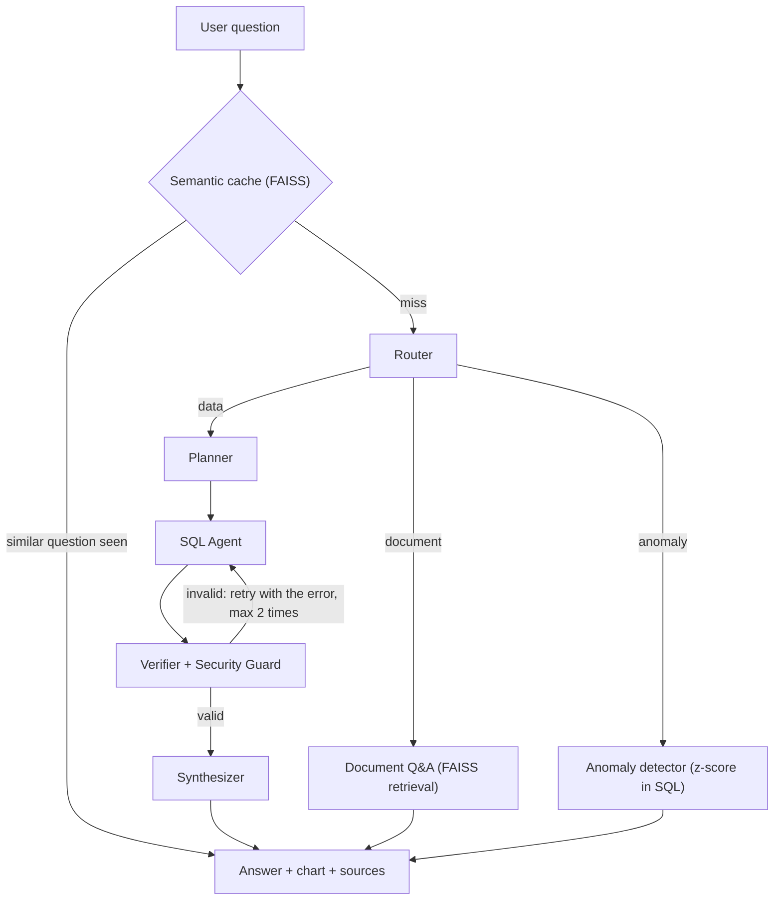

# DataTrust

Ask questions about your data in plain English and get **verified SQL**, an instant chart, and an answer you can check.


DataTrust is a multi-agent NL-to-SQL platform. Instead of letting one LLM guess a query, every question passes through a pipeline of small agents that plan, write, and verify the SQL before anything is run. It also answers questions from uploaded documents and flags unusual records.

## How it works



## The five-stage SQL pipeline

1. **Router** decides whether the question needs the sales data, a document, or an anomaly check.
2. **Planner** picks the columns needed and rejects the question early if the data does not contain them (for example, asking for "profit" when there is no cost column).
3. **SQL Agent** writes one DuckDB query using only the real schema.
4. **Verifier + Security Guard** blocks anything that is not a single read-only `SELECT`, then asks DuckDB to `EXPLAIN` the query. A made-up column fails here, and the error is sent back to the SQL Agent for a retry.
5. **Synthesizer** runs the verified query, picks a chart type by rule, and writes a short answer using only the returned numbers.

## Features

- **Hallucination reduction at several layers:** the schema is given to the model, the Planner checks columns, the Verifier checks the query against the real database, and the Synthesizer may only use returned data.
- **SQL security guard:** only one read-only `SELECT` is allowed. It blocks multiple statements, SQL comments, data-changing keywords, and file-reading functions.
- **FAISS semantic cache:** a reworded repeat of a question is answered instantly with no LLM calls, while a different question (such as "by region" vs "by category") is not reused.
- **Document Q&A (RAG):** upload a `.txt` or `.md` file and ask about it. Answers come only from the retrieved passages, the passages are shown as sources, and the model says so when the document does not contain the answer.
- **Anomaly detection:** flags orders whose quantity is far from normal for their product, using a z-score computed in SQL. No LLM is involved.
- **Instant visualizations:** bar, line, or big-number charts chosen automatically.

## Tech stack

| Layer | Tools |
|---|---|
| Backend | Python, FastAPI |
| Database | DuckDB |
| Vector search | FAISS, fastembed (`BAAI/bge-small-en-v1.5`) |
| LLM | Any OpenAI-compatible API (currently Groq) |
| SQL checking | sqlglot |
| Frontend | React, Vite, Recharts |

## Project structure

```
datatrust/
  backend/
    app/
      agents/     router, planner, sql_agent, verifier, synthesizer, pipeline
      core/       config, database, llm client
      services/   sql_guard, semantic_cache, anomaly, rag
      api/        FastAPI routes
    data/         sales.csv and uploaded documents
    scripts/      sample-data generator and test scripts
    tests/        security guard tests
  frontend/       React app
```